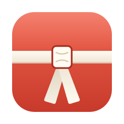
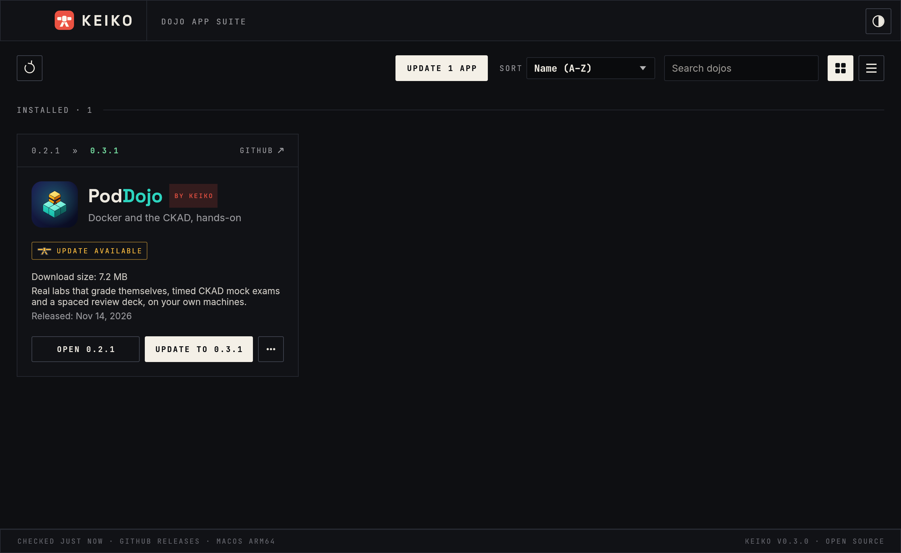
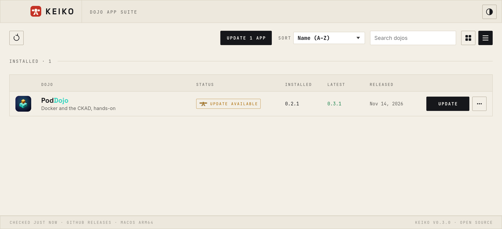

<p align="center">
  
</p>

<h1 align="center">Keiko</h1>

<p align="center">
  <b>Daily practice for builders.</b><br>
  One place to install, update and open the dojo apps: hands-on, open-source study tools.<br>
  Ultralight, native, pure Rust.
</p>

<p align="center">
  
  
  
  
</p>

<p align="center">
  
</p>
<p align="center">
  <br>
  <sub>Grid or list; the theme follows macOS or stays dark or light.</sub>
</p>

*Keiko* (稽古) is the word for practice in the dojo: the training you come back to every day.
Each app in the suite is a **dojo** where you learn by doing, and Keiko is the place you walk in
through.

## The dojos

| Dojo | What you practise | Repository |
|---|---|---|
| **PodDojo** | Docker and the CKAD: auto-graded labs on a real cluster, timed mock exams, spaced review | [bujosa/poddojo](https://github.com/bujosa/poddojo) |

More are coming. A dojo is any app with GitHub releases that follows a few rules; see
[docs/adding-a-dojo.md](docs/adding-a-dojo.md).

## What Keiko does

<table>
  <tr>
    <td width="33%" valign="top">
      <h3>Install in one click</h3>
      Picks the build for your Mac from the dojo's latest GitHub release, checks its SHA-256 against the release's checksums, the bundle identifier and the code signature, then installs it in <code>~/Applications</code>. No administrator password.
    </td>
    <td width="33%" valign="top">
      <h3>Belts, not badges</h3>
      White belt: ready to install. Yellow belt: an update is out. Black belt: you have the latest. Update one dojo or all of them; the previous version is kept aside until the new one is in place.
    </td>
    <td width="33%" valign="top">
      <h3>Always up to date</h3>
      Keiko checks every hour while it is open and sends a macOS notification once for each new version. Keiko updates itself the same way: <b>Update and restart</b>, with the same checks.
    </td>
  </tr>
</table>

Native egui window, no Electron, no web view. Like the dojos, Keiko drives the system's own tools
(`curl`, `ditto`, `plutil`, `codesign`, `open`) instead of bundling an HTTP or TLS stack, so
proxies and certificates behave exactly as in your terminal.

## Download

Get `Keiko-vX.Y.Z-macos-arm64.zip` from the [latest release](https://github.com/bujosa/keiko/releases/latest),
unzip it and move `Keiko.app` to Applications. Builds are signed ad-hoc for now: the first time,
right-click › Open, or run `xattr -dr com.apple.quarantine /Applications/Keiko.app`.

Apps that Keiko installs open directly: Keiko downloads them itself, so macOS does not quarantine
them.

## Private dojos

Public dojos need no account. For a dojo in a private repository Keiko uses a token from
`KEIKO_GITHUB_TOKEN`, `GITHUB_TOKEN` or `GH_TOKEN`, else the GitHub CLI's (`gh auth login`). The
token is only sent to `api.github.com`, passed to `curl` on standard input (never on the command
line), and not forwarded when GitHub redirects a download to its file storage.

## Build from source

```bash
cargo run -p keiko --release        # run it
cargo xtask bundle --install        # build, sign and install Keiko.app in ~/Applications
cargo xtask ci                      # fmt, clippy -D warnings, tests
cargo test -p keiko-native -- --ignored   # installs PodDojo for real into a temp folder (network)
```

Rust 1.99 (pinned in `rust-toolchain.toml`). `KEIKO_HOME` and `KEIKO_APPS_DIR` move Keiko's data
and the install folder (tests, screenshots); `KEIKO_SCREENSHOT=<png>` captures the window once the
first check settles.

## Layout

```text
catalog.toml       every dojo Keiko knows (repository, asset name, bundle id) and Keiko itself
crates/core        catalog, releases, belts (pure: no processes, no network)
crates/native      GitHub through curl, install/update/uninstall, detection, notifications, the cache
apps/keiko         the egui window
xtask              ci, icon, bundle, release
```

## License

MIT OR Apache-2.0, at your option. Fonts are under the SIL Open Font License; see
[ATTRIBUTION.md](ATTRIBUTION.md).
